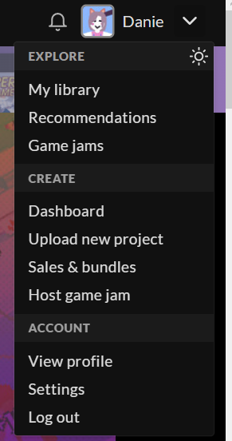
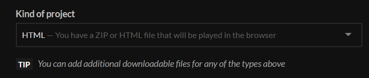
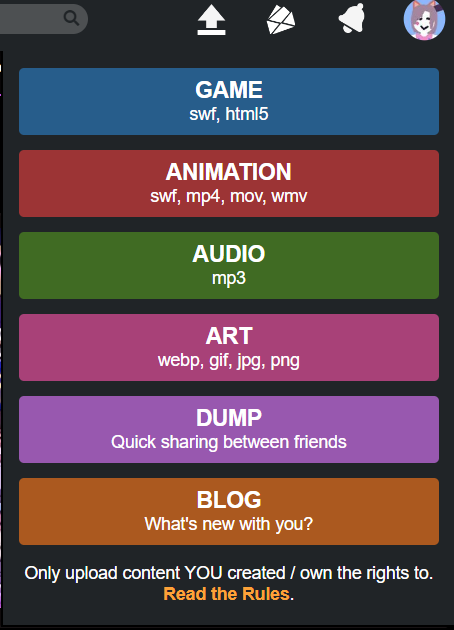

import Info from "@/components/Content/Info.astro";
import Cols from "@/components/Content/Cols.astro";

# Publishing a KAPLAY game

When we finish our game, the most important moment is to... Publish it!

## Preparing the game

We should prepare our game for publishing on different platforms.

### Assets and source code

The first thing you should know is that both your `public` and `dist` folders (or
whatever they are called) should be the same folder. We recommend having a file
tree like this:

```sh
game/
┣ public/ # Or dist/
┃ ┣ sprites/
┃ ┣ sounds/
┃ ┣ index.html # Your bundled index.html file
┃ ┣ game.js # Your bundled game file
```

This way, when you zip `public`, you will have all your assets and code files in
the same folder. This is usually the folder you upload to game platforms like
**Itch.io** and **Newgrounds.com**.

<Info crew="sparkles" title="If you use [create-kaplay](/docs/guides/install)...">
If you use `npx create-kaplay` template, you start with `public` folder for your
assets, but `dist` folder is used for publishing. Assets from `public` will be
included in `dist` automatically after running `npm run build` or `npm run zip`.
Resulting `dist/game.zip` is ready to publish.
</Info>

### Asset paths

When you host your games in web portals, you should use _relative paths_.

Actually, you may have something like this:

```js
loadSprite("bean", "/sprites/bean.png");
```

There's two ways to handle this:

- Update all your imports to start with `./`
- Use `loadRoot()`

`loadRoot()` sets what is added at the start of every url:

```js
loadRoot("."); // will add "." at start of every url

loadSprite("bean", "/sprites/bean.png"); // -> ./sprites/bean.png
```

<Info crew="bean" title="Watch out!">
Your `loadRoot()` depends on how you define URLs. Maybe using `loadRoot("./")`
*is a better option*.
</Info>

```js
loadRoot("./"); // will add "./" at start of every url

loadSprite("bean", "sprites/bean.png"); // -> ./sprites/bean.png
```

Now you should be ready to publish on various platforms!

---

## Itch.io

First, go to your account. Then **Upload new project**.



Then, in **Kind of project**, you should select **HTML**, so itch.io will let
you upload a web game:



After that, the only thing left to do is to upload your zip with your game
files, or if you have a single `index.html` file (very tasteful), upload it!

More details on [**Itch.io Documentation about HTML5 games**](https://itch.io/docs/creators/html5).

---

## Newgrounds.com

First, click on the up arrow icon and select **Game**:



Now, same as with Itch.io, only upload a zip with your fabulous `index.html`
game file and its assets.

---

## Wavedash.com

<Cols class="[&>:last-child]:self-center">
[](/docs/guides/wavedash)

We have a separate guide that will teach you [how to publish on Wavedash](/docs/guides/wavedash)
and integrate its features, such as achievements, leaderboards, and more!
</Cols>

---

<Info crew="burpman" title="Get discovered!">
You can tag your game on different platforms with the tag `kaplayjs` and
`&kaplay`, or set made with KAPLAY if possible. We will probably see it and
even promote on our social media! 😄
</Info>
