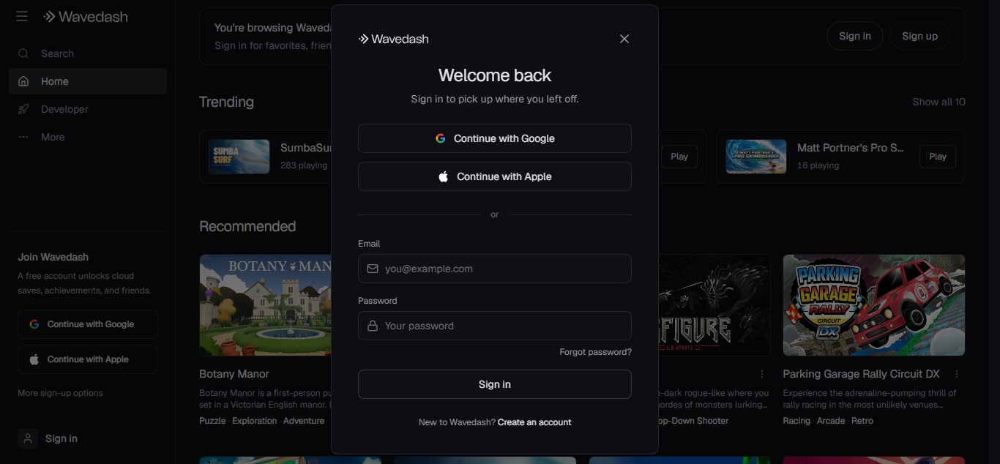

import Info from "@/components/Content/Info.astro";

# What is Wavedash?

You just finished your KAPLAY game, it's a masterpiece, it's the greatest game
that there has ever existed, but now.... Where do you publish it?
How do you go about sharing it to the world so that everyone can see it?

There are always multiple options, but it's difficult to find one that is completely
free, browser-based and has tools and services like social and cloud features, dedicated SDK
and even monetization and a creator fund.

With the online game distribution platform [**Wavedash**](https://wavedash.com/) you'll find all of these features and more.
With **Wavedash** you'll find that players will be able to find your game easily and play it instantly
from different browsers and mobile devices thanks to modern web technologies and more importantly, it
runs your games locally on your device's hardware so the player will have no cloud lag when playing.

And most importantly, **Wavedash** provides developer tools and [SDKs](https://docs.wavedash.com/sdk/overview) that allows YOU as a developer
manage an configure and publish your game all from the CLI and also easily integrate social
features to your game like achievements, leaderboards AND multiplayer.


So you're interested! Good! Now, how do we go about publishing our game to Wavedash? We'll teach you here in a way no one else could!

# How to publish your game in Wavedash?

## Making our game

Let's try to upload our sokoban game into Wavedash, currently, our game's structure looks like this:

```
sokoban
├── node_modules # The folder where our packages were installed
├── public/ # Our assets folder
│ ├── sprites
│ ├── sounds
├── src/ # The folder where our code is located
│ ├── main.js # The main code
├── index.html
├── vite.config.js
├── package-lock.json
└── package.json
```

For this example, we will be using the sokoban example, which can be found and playable [here](https://play.kaplayjs.com/?example=sokoban)! at the [KAPLAYGROUND](https://play.kaplayjs.com)
Ported and exported exported using the [create-kaplay](https://github.com/kaplayjs/create-kaplay).

<Info
    crew="bean"
    title="Where can i find more games?">
Other than the sokoban example, KAPLAY has tons of other polished examples and small contained games in the playground! Find them [here](https://play.kaplayjs.com/).
</Info>

### BUT WAIT!!!!

First, you must understand that when Wavedash loads your game, it will await for it to call the `Wavedash.init()` function from the SDK to unveil it from the loading screen.

You don't have to install and setup the Wavedash SDK into your game as Wavedash will inject its SDK into your code.

You can check if your game is being run into Wavedash's website by checking for `window.Wavedash` in an if, and then run Wavedash.init() after your game is ready to play for it to start! If it's not running in Wavedash's website, it won't do anything, that's why it would be ideal to keep to keep it, if you intend to make Wavedash one of your publishing platforms.

It could look a little bit like this:

```js
kaplay();

add([
    text("My super game!"),
]);

// Now that our main screen is setup and our game ready to play, we can call Wavedash.init()
// We first check that Wavedash exists
if (window.Wavedash) {
    Wavedash.init();
}
```

<Info
    crew="ghosty"
    title="What about the loading screen?">
Right now, the loading screen will go from 0 to your game playing, if you would like to update it more profesionally, you could use the function `Wavedash.updateLoadProgressZeroToOne()` inside the `k.onLoading()` function and pass `k.loadProgress()` as a parameter, so it looks a a bit nicer.

Like this:

```js
onLoading(() => {
    if (window.Wavedash) {
        Wavedash.updateLoadProgressZeroToOne(loadProgress());
    }
});
```

</Info>

## Getting into Wavedash

Before anything, we must first create our account on Wavedash! So everyone can know who published such a great game! In this case, yours.

First we'll enter into our search bar https://wavedash.com and we'll find the homepage:


And we'll direct our eyes to the **Join Wavedash** segment on the bottom left part of the website.

We can either sign up using google or apple, if we don't feel like using either we can press **Sign in** and then the part where it says **Create an account**



Once we have an account, we'll take a look at the topleft side panel, and click the option that says **Developer** and click that. Once we do that, we'll find ourselves here:


We'll create a project and name it, now we have our project!


We can go about different ways to upload our game into Wavedash.

We could either install the CLI in our computers, authenticate and create a `wavedash.toml` file in our project, which looks something like this:

```toml
game_id = "YOUR_GAME_ID_HERE"
upload_dir = "./exports/web"

[godot]
version = "4.5-stable"
```

And we could continue configuring it and uploading it this way, but for the sake of this blog, we'll keep doing the traditional way (uploading it from the developer portal).

<Info
    crew="mark"
    title="I want to go the CLI route!">
If you want to keep learning how to go about this, Wavedash has tons of documentation regarding to uploading your builds this way, it's quite convenient! You can find more about it in: https://docs.wavedash.com/cli/installation
</Info>

## Preparing our build

Now we have to prepare our game into a format that Wavedash understands, how does Wavedash actually make our game playable?

We have to prepare a _build_! Right now our game is only code, but we have to export it in a format that is playable for our browser engine.

We can do this using the command found in the `package.json` file in our project called _"zip"_, like this:

```bash
npm run zip
```

The command that actually builds the `dist` folder (which is the one that we will upload) will differ from project to project, and that's why it's important for you to understand the way that your project is set-up from the get-go.

In this case, we chose to use the `*create-kaplay*` template because it's simple and anyone can create it and effortlessly port their project to it, and start following the tutorial, if you're not using it and you're having trouble exporting your project, consider switching to it! If not, we may continue.

Right now we find ourselves with our dist folder! Which looks a bit like this:

```
dist
├── assets
│ ├── index-CSS9Ze-F.js
│ ├── index-CSS9Ze-F.js.map
├── sprites/ # Our sprites folder
├── sounds/ # Our sounds folder
├── index.html
```

This is the folder that contains all of the important stuff needed for our game to be actually runnable on a browser engine!

We'll zip this file with our compression tool of choice into a `*.zip` file and once we have it, we'll click on the **Upload new build button**!


We'll find ourselves with this screen:


We'll select `Engine > Other` (since we're using KAPLAY) and `Entrypoint > *index.html*`, since it's the entrypoint of our game.
The build message is optional, but if this is not the first build we're uploading we can list our changes to track what has been happening in our builds

And we'll click **Upload build**.

And just like that, we'll have successfully uploaded our first build in our Wavedash project, yay!!

<Info
    crew="beant"
    title="I had issues!">
Oh no! If you had any problem uploading your build, you can either check the official documentation in: https://docs.wavedash.com/ or join the discord server for **Wavedash** _(discord.gg/wavedashdotcom)_ or **KAPLAY** where i'm sure someone will be happy to help you!
</Info>

### Is my game up? Can everyone see it?!

Not yet little kaplayer, we still have a bit of road left until that.

## Playtesting

First, we have to check that our game is fully functional, for this we'll press the **Playtest** button on our build, to check everything is working correctly.


It seems our game is up and running!

## Final touches

To actually publish our game, we have to make it appealing to everyone who is scrolling on Wavedash, we need to add things like a description and a thumbnail, for it to captures the players.

We'll go back by clicking on the project's on the top of the screen and then move from _Builds_ all the way over to **Metadata** which should have a small yellow dot.


You'll have to fill the following fields:

- **Title:** The readable name of your game! It can be different from the game's url.

> Sokoban

- **Description:** What makes your game different? The reason why everyone should play it! It shows up on the game's page, keep it as short as possible, no wall of lore.

> Our rendition on "How to make a sokoban-like game in KAPLAY!"

> Has a few levels, we hope you like it!

- **Cover Art:** A single 16:9 image used as the icon of your game, must be anywhere from 250x140 to 1920x1080 (up to 25 MB). It must read as your game's face. See [content guidelines](https://docs.wavedash.com/publishing/content-guidelines) for what can go in and not.
  

- **Preview Video:** A 16:9 MP4, WebM or MOV between 5 seconds and 5 minutes long up to 200MB. Wavedash keeps the first 10 seconds and drops the audio, this should be an actual preview of what your game looks like, make it a selling point! And lead with gameplay.

<video width="640" height="360" controls>
  <source src="assets/wavedash/game/preview.mp4" type="video/mp4" />
  Your browser does not support the video tag.
</video>
- **Tags:** Words that describe your game's genre and mechanics, these are how players that prefer certain games find you. Favor accuracy over reach.
> Puzzle, Sokoban, 2D

In our case, we also selected Keyboard + Mouse as input method, Wide mobile layout and English as its language.
