import Info from "@/components/Content/Info.astro";
import previewVideo from "./assets/wavedash/game/preview.mp4";

# What is Wavedash?

You just finished your KAPLAY game, it's a masterpiece, it's the greatest game
that there has ever existed, but now.... Where do you publish it?
How do you go about sharing it to the world so that everyone can see it?

There are always multiple options, but it's difficult to find one that is completely
free, browser-based and has tools and services like social and cloud features, dedicated SDK
and even monetization and a creator fund.

With the online game distribution platform [**Wavedash**](https://wavedash.com/) you'll find all of these features and more.
With **Wavedash** you'll find that players will be able to find your game easily and play it instantly
from different browsers and mobile devices thanks to modern web technologies and more importantly, it
runs your games locally on your device's hardware so the player will have no cloud lag when playing.

And most importantly, **Wavedash** provides developer tools and [SDKs](https://docs.wavedash.com/sdk/overview) that allows YOU as a developer
manage an configure and publish your game all from the CLI and also easily integrate social
features to your game like achievements, leaderboards AND multiplayer.

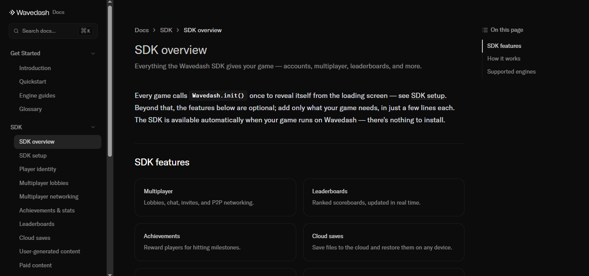

So you're interested? Good! Now, how do we go about publishing our game to Wavedash? We'll teach you here in a way no one else could!

# How to publish your game in Wavedash?

## Making our game

For this example, we will be using the sokoban example, which can be found and playable [here](https://play.kaplayjs.com/?example=sokoban) at the [KAPLAYGROUND](https://play.kaplayjs.com)!
Ported and exported using [`create-kaplay`](https://github.com/kaplayjs/create-kaplay).

Let's try to upload our sokoban game into Wavedash, currently, our game's structure looks like this:

```
sokoban
├── node_modules # The folder where our packages were installed
├── public/ # Our assets folder
│ ├── sprites
│ ├── sounds
├── src/ # The folder where our code is located
│ ├── main.js # The main code
├── index.html
├── vite.config.js
├── package-lock.json
└── package.json
```

<Info
    crew="bean"
    title="Where can i find more games?">
Other than the sokoban example, KAPLAY has tons of other polished examples and small self-contained games in the playground! Find them [here](https://play.kaplayjs.com/).
</Info>

### BUT WAIT!!!!

First, you must understand that when Wavedash loads your game, it applies its own loading screen on top of your game, and doesn't remove that until you call the `Wavedash.init()` function from the SDK.

You can check if your game is being run into Wavedash's website by checking for `window.Wavedash` in an if, and then run Wavedash.init() after your game is ready to play for it to start! If it's not running in Wavedash's website, it won't do anything, that's why it would be ideal to keep to keep it, if you intend to make Wavedash one of your publishing platforms.

It could look a little bit like this:

```js
kaplay();

add([
    text("My super game!"),
]);

// Now that our main screen is setup and our game ready to play, we can call Wavedash.init()
// We first check that Wavedash exists
if (window.Wavedash) {
    Wavedash.init();
}
```

<Info
    crew="ghosty"
    title="What about the loading screen?">
Right now, the loading screen will go from 0 to your game playing, if you would like to update it more profesionally, you could use the function `Wavedash.updateLoadProgressZeroToOne()` inside the `k.onLoading()` function and pass `k.loadProgress()` as a parameter, so it looks a a bit nicer, like this:

```js
onLoading(() => {
    if (window.Wavedash) {
        Wavedash.updateLoadProgressZeroToOne(loadProgress());
    }
});
```

</Info>

## Getting into Wavedash

Before anything, you must first create an account on Wavedash, so everyone can know who published such a great game -- in this case, you!

First, just go to https://wavedash.com

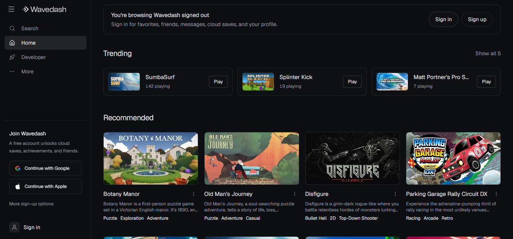

We can either sign up using google, apple, or the usual email and password option below them.

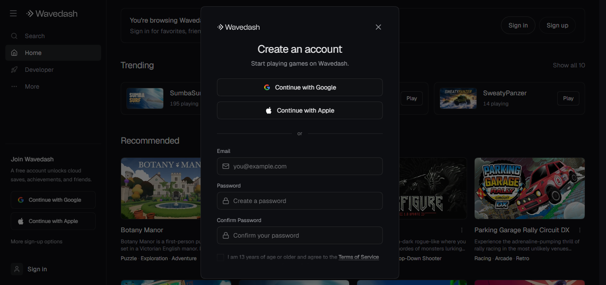

Once you have an account, we'll take a look at the top left side panel, and click the option that says **Developer**. That will take you here:

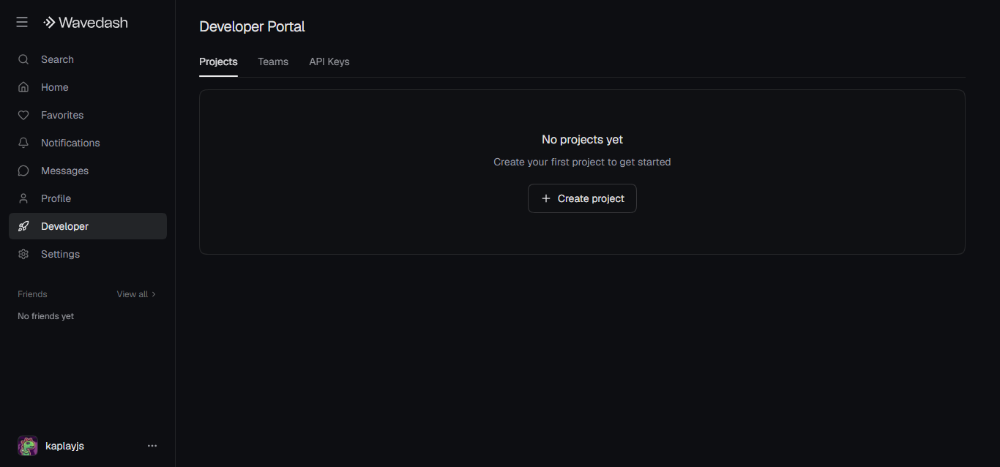

Create a project and name it, now you have your project!

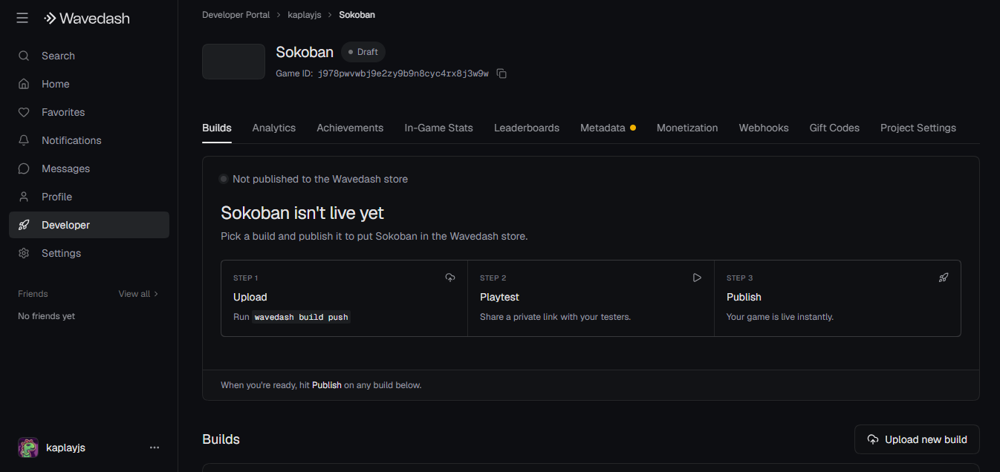

We can go about different ways to upload our game into Wavedash.

We could either install the CLI in our computers, authenticate and create a `wavedash.toml` file in our project, which looks something like this:

```toml
game_id = "YOUR_GAME_ID_HERE"
upload_dir = "./dist"
entrypoint = "index.html"
```

Or we could continue configuring it and uploading it this way, for the sake of this blog, we'll keep doing the traditional way (uploading it from the web interface).

<Info
    crew="mark"
    title="I want to go the CLI route!">
If you want to keep learning how to go about this, Wavedash has tons of documentation regarding to uploading your builds this way, it's quite convenient! You can find more about it in: https://docs.wavedash.com/cli/installation
</Info>

## Preparing our build

Now you have to prepare your game into a format that Wavedash understands.

So how does Wavedash actually make our game playable?

You have to prepare a _build_! Right now the game is just a bunch of code and asset files sitting in a folder on your computer, but you can't upload each file individually to Wavedash.

Wavedash expects a .zip file containing all of the HTML, JavaScript, CSS, and assets (such as sounds and sprites) that the game needs.

This might be different than the way you have your game set up for testing locally, so if you are confused, stop and make sure you understand what files the game is loading, and from where, when you start your game locally for testing.

In this case, we have used _`create-kaplay`_ to set up the project because it's simple and anyone can use it and effortlessly port their project to it and start following the tutorial. If you're not using it and you're having trouble exporting your project, consider switching to it! If not, continue.

_`create-kaplay`_ includes a `package.json` script called `zip`, which does the exact things needed to create the .zip file that can be uploaded to Wavedash. So open a terminal and run

```sh
npm run zip
```

At this point, you should find in your `dist/` folder:

```
dist
├── assets
│ ├── index-CSS9Ze-F.js
│ ├── index-CSS9Ze-F.js.map
├── sprites/ # Our sprites folder
├── sounds/ # Our sounds folder
├── index.html
```

This is the folder that contains all of the important stuff needed for our game to be actually runnable on a browser engine!

If you ran `npm run zip`, you'll also have a `game.zip` file alongside this. Once you have a zip file of your game, go back to Wavedash and click on the **Upload new build** button!

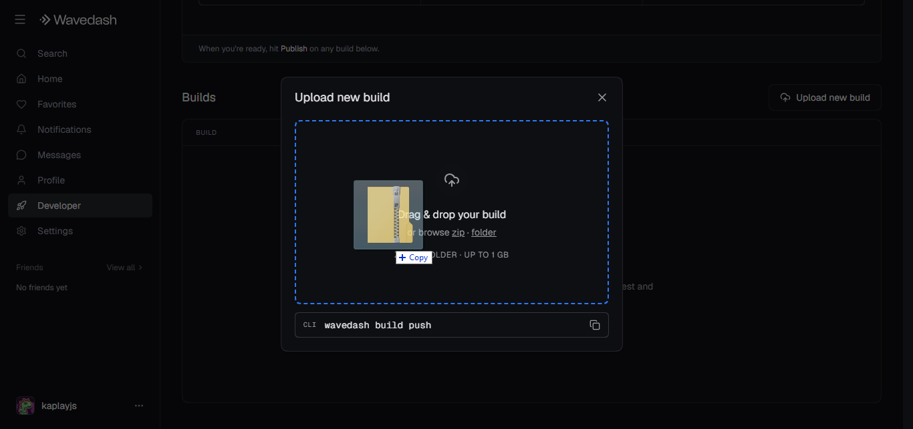

Once it finishes uploading, you will get this screen:

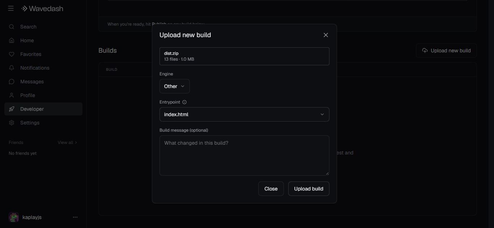

Select `Engine > Other` (since we're using KAPLAY) and `Entrypoint > *index.html*`, since it's the entrypoint of our game.

The build message is optional, but if this is not the first build you're uploading, you can paste the list of new changes from your changelog.
Finally, click **Upload build**.

And just like that, you'll have successfully uploaded your first build in your Wavedash project, yay!!

<Info
    crew="beant"
    title="I had issues!">
Oh no! If you had any problem uploading your build, you can either check the official documentation in: https://docs.wavedash.com/ or join the discord server for **Wavedash** _(discord.gg/wavedashdotcom)_ or **KAPLAY** where i'm sure someone will be happy to help you!
</Info>

### Is my game up? Can everyone see it?!

Not yet little kaplayer, we still have a bit of road left until that.

## Playtesting

First, you have to check that your game is fully functional. Press the **Playtest** button on our build, to check everything is working correctly.

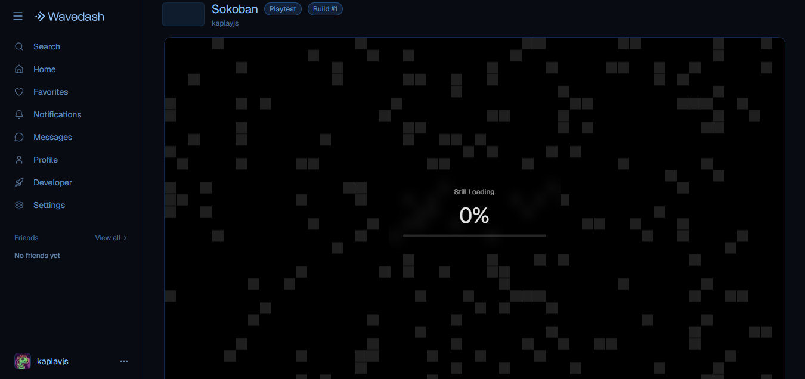

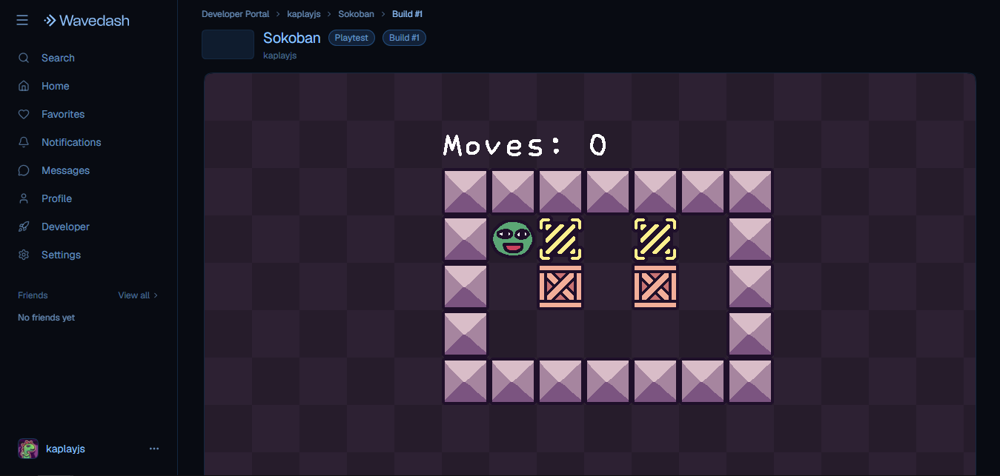

It seems our game is up and running!

## Final touches

To actually get people to play your game, you have to make it appealing to everyone who is scrolling on Wavedash. So, you need to add things like a description and a thumbnail.

Go back by clicking on the projects on the top of the screen and then select the **Metadata** tab which should have a small yellow dot. (Wavedash highlights this after you upload your first build since every game needs some amount of metadata!)
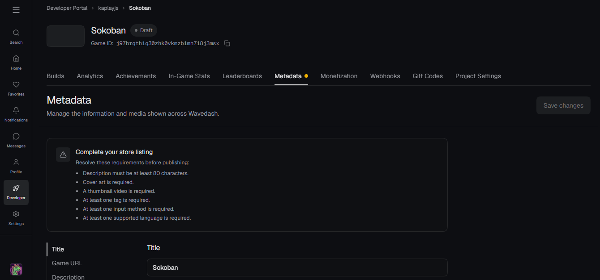

You'll have to fill the following fields:

- **Title:** The readable name of your game! It can be different from the game's url.

> Sokoban

- **Description:** What makes your game different? The reason why everyone should play it! It shows up on the game's page, keep it as short as possible, no wall of lore.

> Our rendition on "How to make a sokoban-like game in KAPLAY!"

> Has a few levels, we hope you like it!

- **Cover Art:** A single 16:9 image used as the icon of your game, must be anywhere from 250x140 to 1920x1080 (up to 25 MB). It must read as your game's face. See [content guidelines](https://docs.wavedash.com/publishing/content-guidelines) for what can go in and not.
  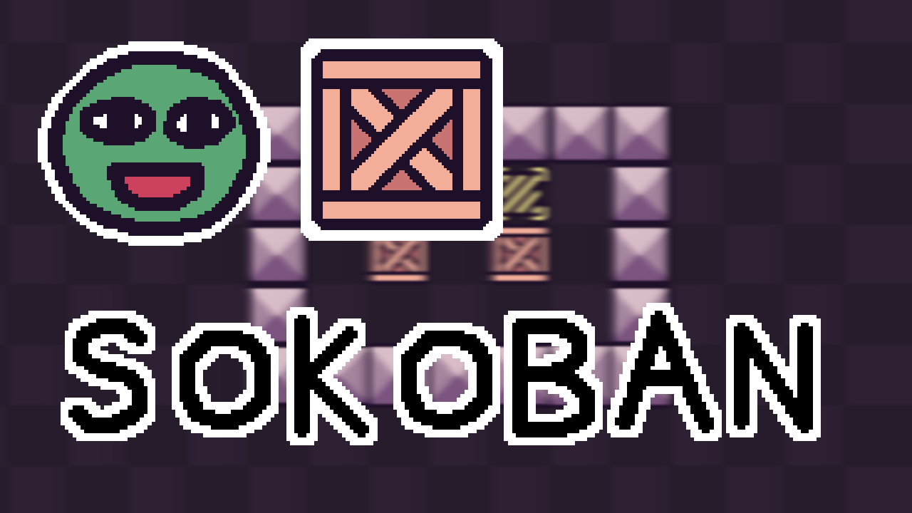

- **Preview Video:** A 16:9 MP4, WebM or MOV between 5 seconds and 5 minutes long up to 200MB. Wavedash keeps the first 10 seconds and drops the audio, this should be an actual preview of what your game looks like, make it a selling point! And lead with gameplay.

  <video width="640" height="360" controls>
    <source src={previewVideo} type="video/mp4" />
    </video>

- **Tags:** Words that describe your game's genre and mechanics, these are how players that prefer certain games find you. Favor accuracy over reach.

> Puzzle, Sokoban, 2D

In our case, we also selected Keyboard + Mouse as input method, Wide mobile layout and English as its language.

<Info
    crew="beenking"
    title="This metadata might sound familiar...">
If you are familiar with Steam games, these images and preview videos are the exact same kind of things that get put on Steam pages! So, keep these videos for later and don't delete them from your computer once you've uploaded them to Wavedash --- if you ever want to also publish to Steam later, you can reuse them!
</Info>
In our case, we also selected Keyboard + Mouse as input method, Wide mobile layout and English as its language.
