import Info from "@/components/Content/Info.astro";
import previewVideo from "./assets/wavedash/game/preview.mp4";

You just finished your KAPLAY game, it's a masterpiece, it's the greatest game
that there has ever existed, but now.... Where do you publish it?
How do you go about sharing it to the world so that everyone can see it?

There are always multiple options, but it's difficult to find one that is completely
free, browser-based and has tools and services like social and cloud features, dedicated SDK
and even monetization and a creator fund. Have you been looking for it? Good! Because do i have the page for you...

# What is Wavedash?

With the online game distribution platform [**Wavedash**](https://wavedash.com/) you'll find all of these features and more.
With **Wavedash** you'll find that players will be able to find your game easily and play it instantly
from different browsers and mobile devices thanks to modern web technologies and even better, it
runs your games locally on your device's hardware so the player will have no cloud lag when playing.

And most importantly, **Wavedash** provides developer tools and [SDKs](https://docs.wavedash.com/sdk/overview) that allows YOU as a developer
to manage and configure and publish your game all from the CLI while also allowing to easily integrate social
features to your game like achievements, leaderboards AND multiplayer, isn't that cool?

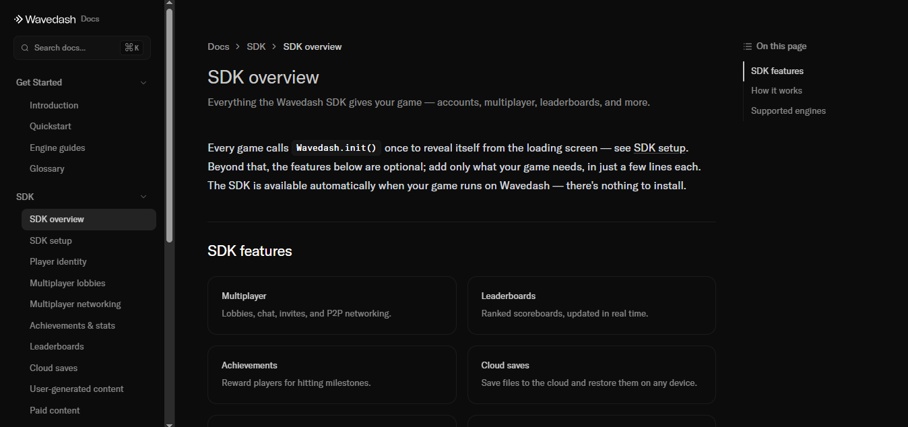

So you're interested? Good! Now, how do we go about it? Let's dive into the guide, where we'll teach you how to publish your game in Wavedash in a way no one else could!

### **This guide will cover:**

- How to _sign up_ in [Wavedash](https://wavedash.com)
- What things do you need to get it published?
- How to _actually_ publish your game
- How to add final touches, such as _achievements_ and _leaderboards_, integrating them with Wavedash

### **Prerequisites or good to know/have:**

- Same as **KAPLAY**'s: Node.js, npm and Git installed ideally
- Understanding your project's setup and `create-kaplay`

# How to publish your game in Wavedash?

## Making our game

For this example, we will be using the sokoban example, which can be found and playable [here](https://play.kaplayjs.com/?example=sokoban) at the [KAPLAYGROUND](https://play.kaplayjs.com)!
Ported and exported using [`create-kaplay`](https://github.com/kaplayjs/create-kaplay).

We'll upload our sokoban game into Wavedash, currently, our game's structure looks like this:

```
sokoban
├── node_modules # The folder where our packages were installed
├── public/ # Our assets folder
│ ├── sprites/
│ ├── sounds/
├── src/ # The folder where our code is located
│ ├── main.js # The main code
├── index.html
├── vite.config.js
├── package-lock.json
└── package.json
```

<Info
    crew="bean"
    title="Where can i find more games?">
Other than the sokoban example, KAPLAY has tons of other polished examples and small self-contained games in the playground! Find them [here](https://play.kaplayjs.com/).
</Info>

### BUT WAIT!!!!

First, you must understand that when Wavedash loads your game, it applies its own loading screen on top of your game, and doesn't remove that until you call the `Wavedash.init()` function from the SDK.

You can check if your game is being run into Wavedash's website by checking for `window.Wavedash` in an if, and then run `Wavedash.init()` after your game is ready to play for it to start! If it's not running in Wavedash's website, it won't do anything, that's why it would be ideal to keep to keep it, if you intend to make Wavedash one of your publishing platforms.

It could look a little bit like this:

```js
kaplay();

add([
    text("My super game!"),
]);

// Now that our main screen is setup and our game ready to play, we can call Wavedash.init()
// We first check that Wavedash exists
if (window.Wavedash) {
    Wavedash.init();
}
```

<Info
    crew="ghosty"
    title="What about the loading screen?">
Right now, the loading screen will go from 0 to your game playing, if you would like to update it more profesionally, you could use the function `Wavedash.updateLoadProgressZeroToOne()` inside the `k.onLoading()` function and pass `k.loadProgress()` as a parameter, so it looks a a bit nicer, like this:

```js
onLoading(() => {
    if (window.Wavedash) {
        Wavedash.updateLoadProgressZeroToOne(loadProgress());
    }
});
```

</Info>

## Getting into Wavedash

Before anything, you must first create an account on Wavedash, so everyone can know who published such a great game -- in this case, you!

First, just go to https://wavedash.com.

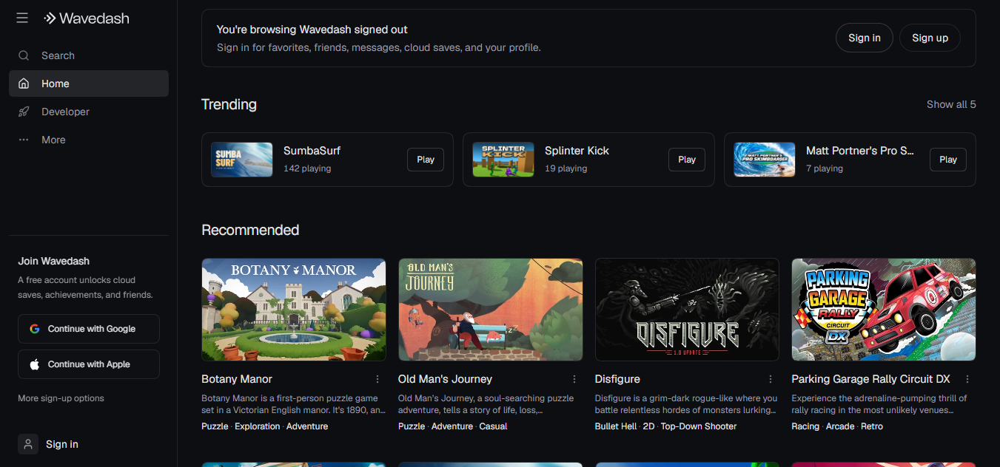

We can either sign up using google, apple, or the usual email and password option below them.

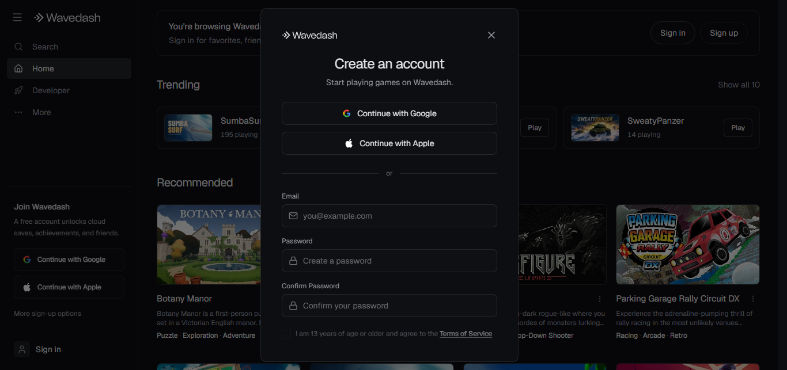

Once you have an account, we'll take a look at the top left side panel, and click the option that says **Developer**. That will take you here:

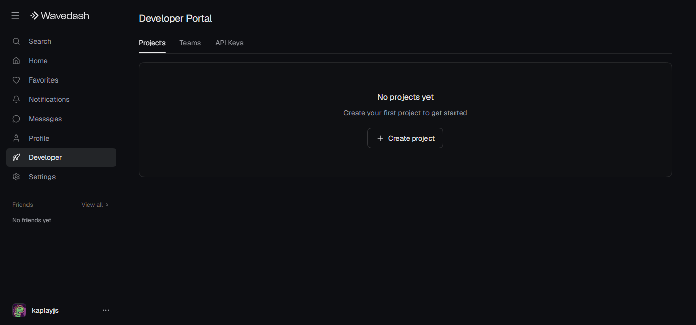

Create a project and name it, now you have your project!

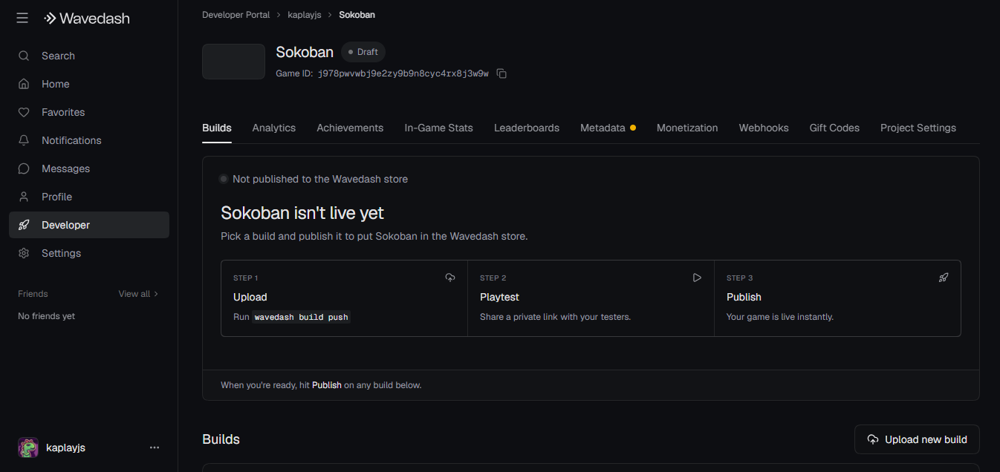

We can go about different ways to upload our game into Wavedash.

We could either install the CLI in our computers, authenticate and create a `wavedash.toml` file in our project, which looks something like this:

```toml
game_id = "YOUR_GAME_ID_HERE"
upload_dir = "./dist"
entrypoint = "index.html"
```

Or we could continue configuring it and uploading it this way, for the sake of this blog, we'll keep doing the traditional way (uploading it from the web interface).

## Preparing our build

Now you have to prepare your game into a format that Wavedash understands.

So how does Wavedash actually make your game playable?

You have to prepare a _build_! Right now the game is just a bunch of code and asset files sitting in a folder on your computer, but you can't upload each file individually to Wavedash.

Wavedash expects a .zip file containing all of the HTML, JavaScript, CSS, and assets (such as sounds and sprites) that the game needs.

This might be different than the way you have your game set up for testing locally, so if you are confused, stop and make sure you understand what files the game is loading, and from where, when you start your game locally for testing.

In this case, we have used _`create-kaplay`_ to set up the project because it's simple and anyone can use it and effortlessly port their project to it and start following the tutorial. If you're not using it and you're having trouble exporting your project, consider switching to it! If not, continue.

_`create-kaplay`_ includes a `package.json` script called `zip`, which does the exact things needed to create the `.zip` file that can be uploaded to Wavedash. So open a terminal and run

```sh
npm run zip
```

At this point, you should find in your `dist/` folder:

```
dist
├── assets
│ ├── index-CSS9Ze-F.js
│ ├── index-CSS9Ze-F.js.map
├── sprites/ # Our sprites folder
├── sounds/ # Our sounds folder
└── index.html
```

This is the folder that contains all of the important stuff needed for our game to be actually runnable on a browser engine!

If you ran `npm run zip`, you'll also have a `game.zip` file alongside this. Once you have a zip file of your game, go back to Wavedash and click on the **Upload new build** button!

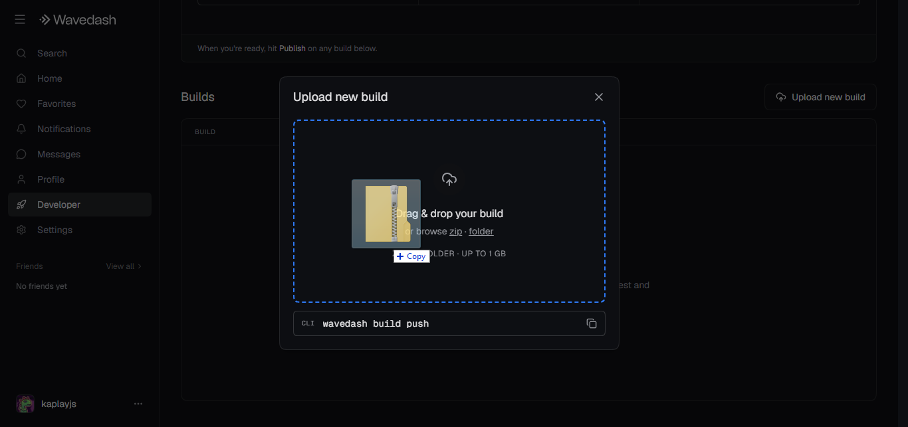

Once it finishes uploading, you will get this screen:

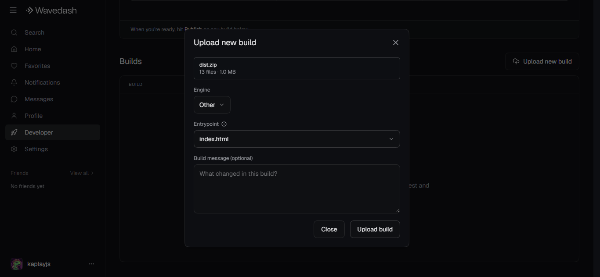

Select `Engine > Other` (since we're using KAPLAY) and `Entrypoint > *index.html*`, since it's the entrypoint of our game.

The build message is optional, but if this is not the first build you're uploading, you can paste the list of new changes from your changelog.
Finally, click **Upload build**.

And just like that, you'll have successfully uploaded your first build in your Wavedash project, yay!!

<Info
    crew="beant"
    title="I had issues!">
Oh no! If you had any problem uploading your build, you can either check the official documentation in: https://docs.wavedash.com/ or join the discord server for **Wavedash** _(discord.gg/wavedashdotcom)_ or [**KAPLAY**](https://discord.com/invite/aQ6RuQm3TF) where i'm sure someone will be happy to help you!
</Info>

### Is my game up? Can everyone see it?!

Not yet little kaplayer, we still have a bit of road left until that.

## Playtesting

First, you have to check that your game is fully functional. Press the **Playtest** button on our build, to check everything is working correctly.

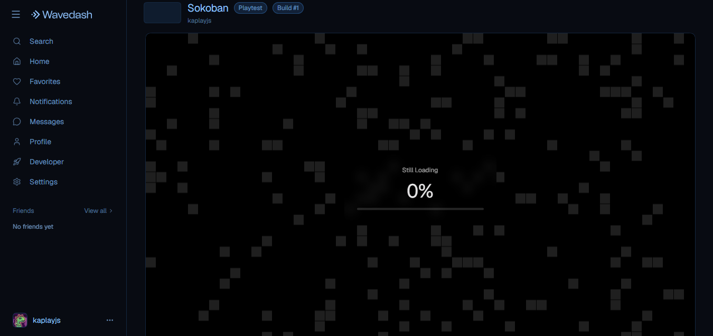

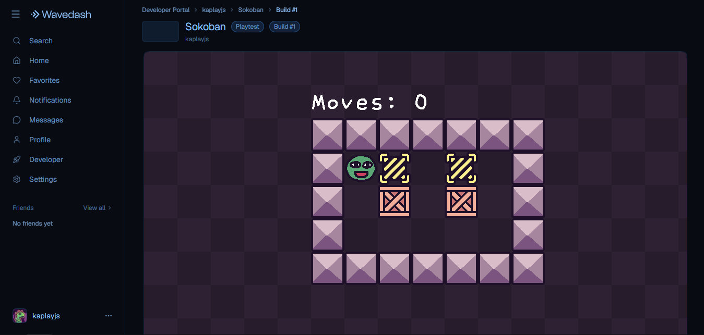

It seems our game is up and running!

## Final touches

To actually get people to play your game, you have to make it appealing to everyone who is scrolling on Wavedash. So, you need to add things like a description and a thumbnail.

Go back by clicking on the projects on the top of the screen and then select the **Metadata** tab which should have a small yellow dot. (Wavedash highlights this after you upload your first build since every game needs some amount of metadata!)
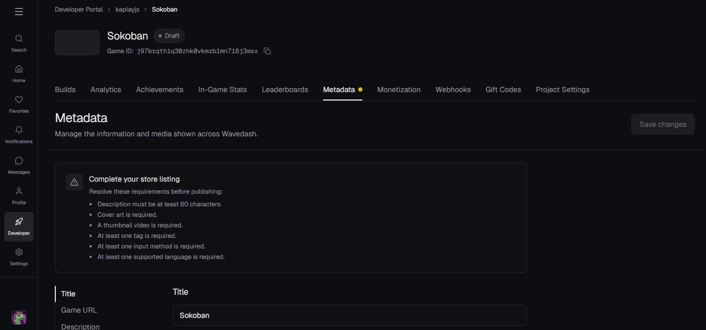

You'll have to fill the following fields:

- **Title:** The readable name of your game! It can be different from the game's url.

> Sokoban

- **Description:** What makes your game different? The reason why everyone should play it! It shows up on the game's page, keep it as short as possible, no wall of lore.

> Our rendition on "How to make a sokoban-like game in KAPLAY!"

> Has a few levels, we hope you like it!

- **Cover Art:** A single 16:9 image used as the icon of your game, must be anywhere from 250x140 to 1920x1080 (up to 25 MB). It must read as your game's face. See [content guidelines](https://docs.wavedash.com/publishing/content-guidelines) for what can go in and not.
  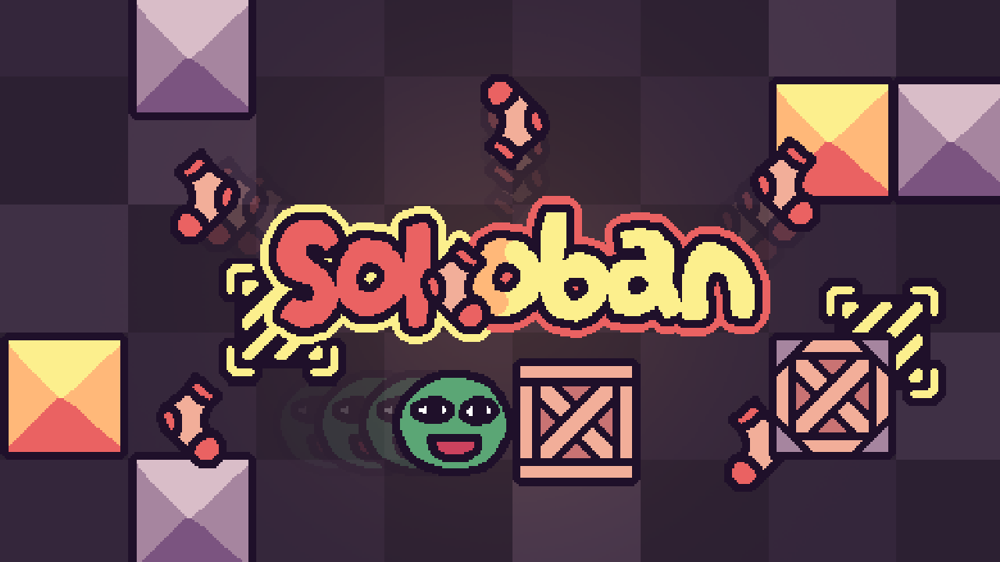

- **Preview Video:** A 16:9 MP4, WebM or MOV between 5 seconds and 5 minutes long up to 200MB. Wavedash keeps the first 10 seconds and drops the audio, this should be an actual preview of what your game looks like, make it a selling point! And lead with gameplay.

  <video width="640" height="360" controls>
    <source src={previewVideo} type="video/mp4" />
    </video>

- **Tags:** Words that describe your game's genre and mechanics, these are how players that prefer certain games find you. Favor accuracy over reach.

> Puzzle, Sokoban, 2D

In our case, we also selected Keyboard + Mouse as input method, Wide mobile layout and English as its language.

<Info
    crew="beenking"
    title="This metadata might sound familiar...">
If you are familiar with Steam games, these images and preview videos are the exact same kind of things that get put on Steam pages! So, keep these videos for later and don't delete them from your computer once you've uploaded them to Wavedash --- if you ever want to also publish to Steam later, you can reuse them!
</Info>

And once we've put the finishing touches, we'll go back to the **builds** tab and click <u>**publish**</u> on the publish you want to make public to everyone, after that, Wavedash will show this screen.
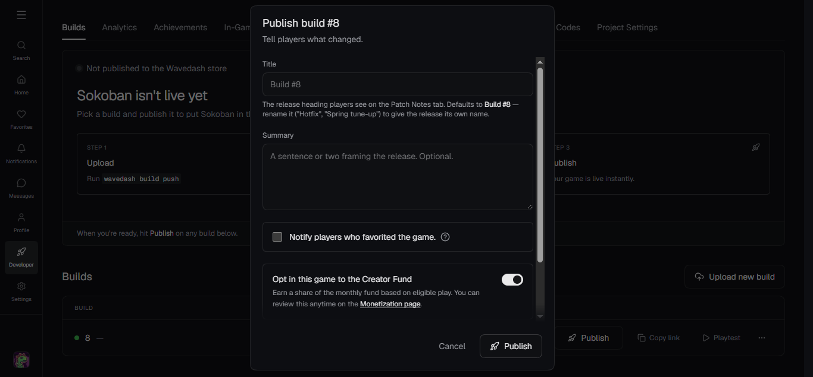

Here, you'll name your release build, it can be something like first release or 1.0 so everyone knows it's the first version of the game.

And with that, we have finally published our game in Wavedash! YAY!!!

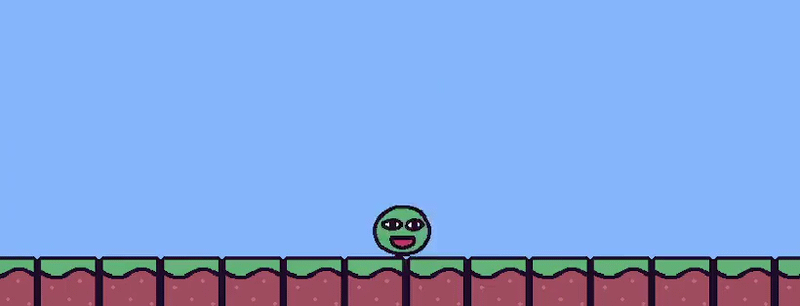

Let's look at our profile and see it!

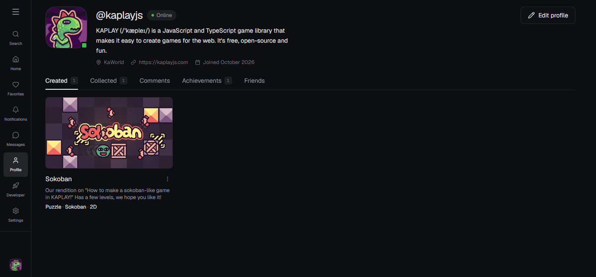

Ahhh... doesn't that look nice... 😌 All of your hardwork has payed off and it's out there! For all of the world to see!! Must be nice, we're extremely proud of you!

You should take a break! And baste yourself in all of your work, try your game! play it and re-play it, send it to all of your friends!

But hey, between us, there's more you can do for your game after it's out, you know? Rest for a bit, prepare yourself and then, only then, and i'll tell you...

...

<Info
    crew="zombean"
    title="Have you been working for long?">
I know how it feels, it's really important that you take short breaks every now and then, experts recommend you take a 15 minute break n' stretch for every hour you spend sitting working, you don't want to look like a zombean do you?
</Info>

# How do i add extra touches?

... All well rested and energized? Good! Now, let's get into:

## Achievements and leaderboards

Wavedash offers us the possibility to add things like _achievements_ and _leaderboards_ into our games, now why would we do that? It may seem like a hassle and unnecesary now that our game is out, but it actually makes your game even more enjoyable! How so? Well..

**Achievements:** They offer developer-controlled goals, clear objectives that players can follow.
These are actually very useful too because YOU as a developer can make use of them in a way that players get hints of what they need to do,
even exploring to find new areas or mechanics, while also activating the part of the brain inside players that makes them want to get every single one and complete the game to the max!

In our game, we'll make a simple achievement for finishing the game and one for finishing in the least possible amount of moves, what will you make? You can always use them as breadcrumbs to guide players in the right path to understand the mechanics.

- **"Finished!"** Complete the game. 
- **"Couch potato"** Complete the game in the least amount of moves possible. 

**Leaderboards:** Although less common, they do make an appearence in certain games with a more competitive aspect to them, not only games with multiplayer like shooters or fighting games but also
certain games with stats, like platformers! Where sometimes players will fight with each other to reach a certain level as fast as possible, these can be tracked with an online leaderboard where the person with less time
is the winner. This makes players want to practice and play your game to death, until they're better than anyone else muehehehe.

We'll make a single one where the players that finish with the least amount of moves, go on top, and the more moves you take you'll get farther down :(

- **"Moves"** A descending leaderboard for the amount of moves a player takes to complete the game.

Now, we've decided we want to add achievements and leaderboards into our game and we have drafted up the necessary things for them, but how do we get them into our game?

## Achievements

First, we'll get into achievements, click on the **Achievements** tab, on the same row where we found _Builds_ and _Metadata_, you'll find this page:

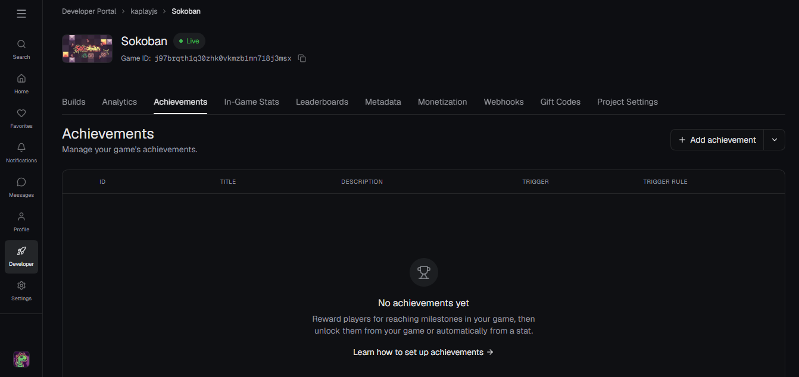

This means you have NO achievements, let's make one! Click on **Add achievement**

You'll find this panel, we filled ours so you have a little idea of how it should look like when filled.

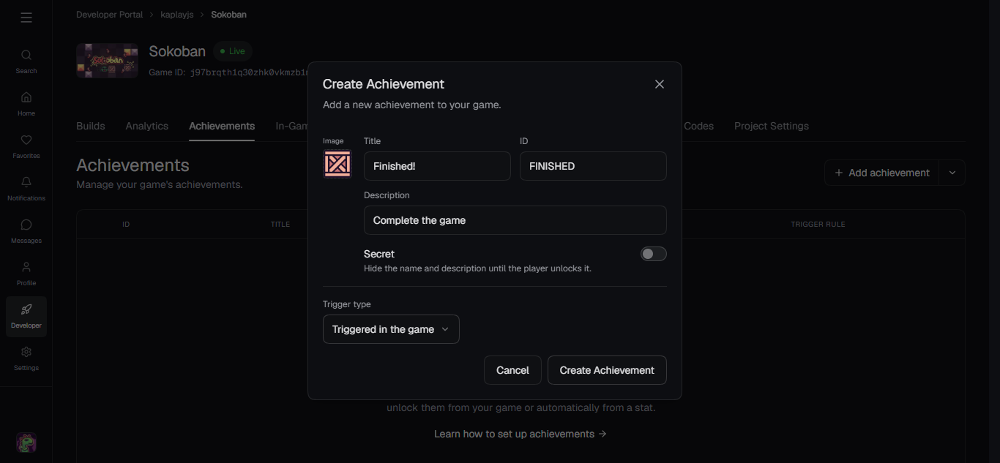

- Image: The icon for your game, you can use a random sprite or design one specifically for it!
- Title: The readable name of your achievement.
- ID: The code name for your achievement, Wavedash will automatically assign it but you can change it to snake_case, camelCase or kebab-case.
- Description: Any text regarding your achievement, you either give instructions on how to give it and a little witty joke on it :)
- Secret: Wheter the information related to the icon won't be revelead to the player until they unlock it.
- Trigger type: Wavedash offers to unlock the icon automatically for you once a certain statistic has been reached, these statistics come from the **Statistics** tab, we won't get into it but you can read more about it [here](https://docs.wavedash.com/sdk/achievements) along the documentation for achievements.

<Info
crew="gigagantrum"
title="But i have too many achievements! What shall i do?!">
Don't fret my little Gigagantrum, Wavedash offers a way to import your achievements in bulk, using the following JSON format:

```json
{
    "achievements": [
        {
            "identifier": "FIRST_KILL",
            "display_name": "First Blood",
            "description": "Get your first kill",
            "secret": false,
            "stat_requirement": null
        },
        {
            "identifier": "GOLD_100K",
            "display_name": "Rich!",
            "description": "Collect 100,000 gold",
            "stat_requirement": {
                "stat": "GOLD_COLLECTED",
                "threshold": 100000
            }
        }
    ],
    "stats": [
        {
            "identifier": "GOLD_COLLECTED",
            "display_name": "Gold Collected"
        }
    ]
}
```

It also works for importing stats easily, but do keep in mind that existing achievements/stats will be overwritten! You can use this feature by clicking on the the little dropdown arrow to the side of the **Add achievement** button.

</Info>

We've added the least moves achievement too, but didn't make it secret as to tease players with the possibility that there's a smarter path, aha!

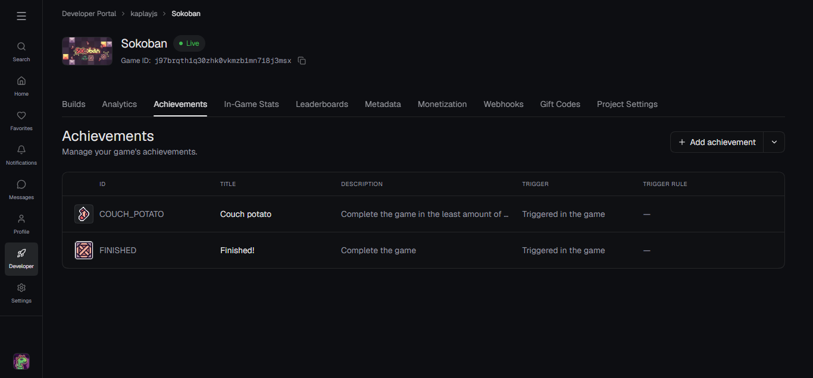

Now that our achievements exist, how do we make it so they actually get unlocked INSIDE the game?

We can _achieve_ this, with a one-liner! We have to call:

```js
Wavedash.setAchievement("first_win", true);
```

Which takes 2 parameters, the ID field of the achievement and wheter we want to save the achievement to the server right now, by-passing a brief auto-save delay.

That's it! No more, in our case, if we want to unlock the "Finished!" achievement, it would look a little bit like this:

```js
if (currentIdx > levels.length - 1) {
    if (window.Wavedash) Wavedash.setAchievement("FINISHED", true);
    go("win");
}
```

If this is the last level in the `levels` array, we check if window.Wavedash exists, and if it does, we unlock the achievement with the `ID` "Finished" and unlock it without waiting for sync, then we go to the "win" scene, pretty simple right?

Now you have to check what are the conditions for your achievement to unlock, this usually runs inside a function or an if that's being constantly checked, be very thorough when checking the conditions, you don't want your players to mistakenly get the achievement with too much or not enough difficulty.

<Info
crew="karat"
title="Hey, psshh">
If you need to check if an achievement has been unlocked in your game to color a little icon or whatever, you can always do:

```js
Wavedash.getAchievement("FINISHED");
```

Which will return a boolean that will be true when the achievement is unlocked, add cutesie colors to your games people!
</Info>

Once you've modified your code and made your build, go back to the **Builds** tab, you'll have to upload it, now that your game is publihed, this build will **NOT** be published, since it's unpublished, no one will be able to play it for now, only you and the people with your link, phew...

Now, play for a bit and try to unlock your achievement, remember to playtest very thoroughly and oh-!

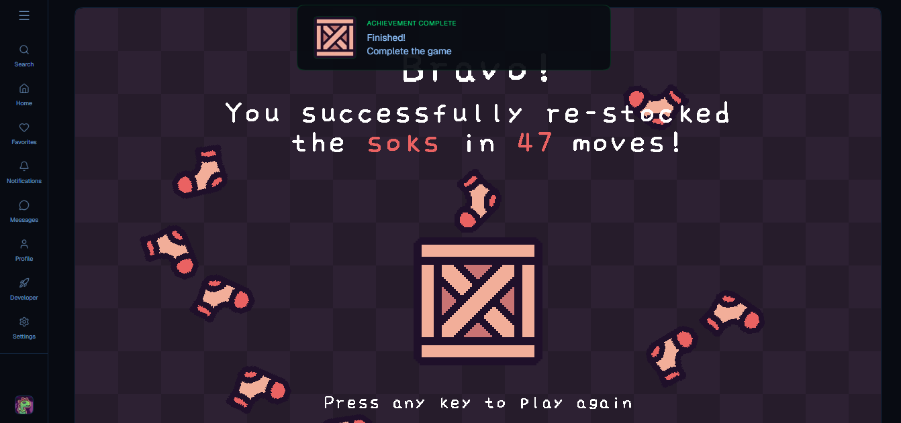

We were able to unlock ours! Pretty neat, were you able to unlock yours? I hope so.

After creating and implementing our achievements we'll publish our new build with them working, when publishing for the second time you'll find this panel:

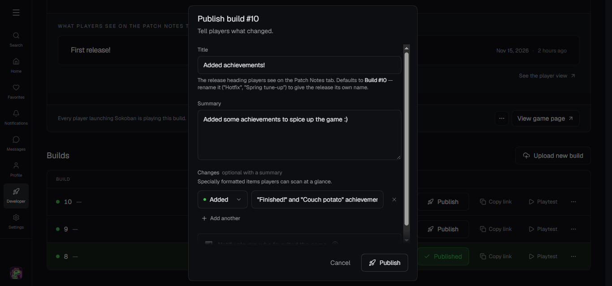

We filled it a bit with the changes we made, now we click publish and yup! Our new build is online, yoo-hoo! Now every player that opens the game will be playing this build, as it will overwrite the previous one, pretty neat.

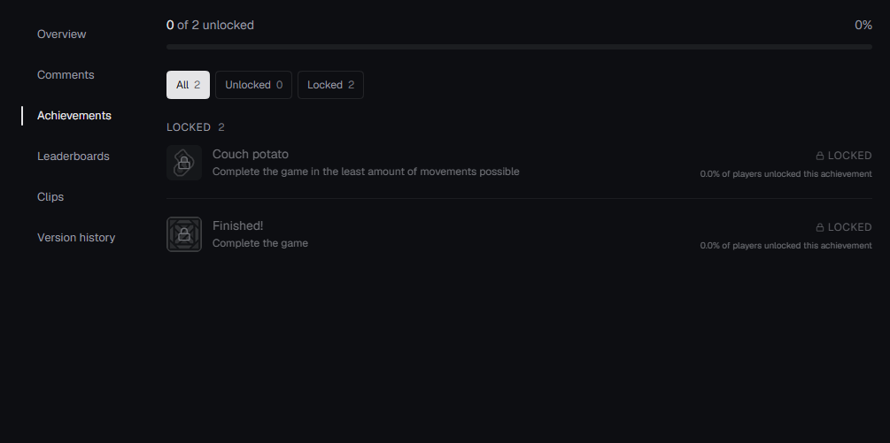

Below our game, in the side panel with all the information related to our game, we can click on the **Achievements** button and see they're now available for everyone! The one we unlocked appears as LOCKED because it was unlocked in playtesting, so it will automatically not count.

Nice! Now that we've added achievements, how about we move to _leaderboards_?

## Leaderboards

Now that we've done achievements, leaderboards are more or less the same process, we'll go to the **Achievements** tab in our game project, on the same part where we find **Builds**, **Achievements** and **Metadata**, we've learned to navigate the Wavedash project page, nice!


Let's go ahead and click on that **New leaderboard** button shall we?


Leaderboards are a lot simpler than achievements! We have:

- Name: Similar to the ID field that we pass when unlocking achievements, it's a codename for our leaderboard, but in this case it's NOT the id, more on that later.
- Display name: The readable name of our leaderboard, the one everyone will recognize it as.
- Sort: Wheter the leaderboard is ascending or descending in its values.
- Display: How the values will be displayed, they can be displayed as a raw number or time (seconds/miliseconds/game ticks).
- Visibility: Wheter the leaderboard will be visible to everyone or not.

Once we click on **Create leaderboard** we'll have our leaderboard created, but the thing is... How do we put values in it...

Actually, in a pretty similar way to how we unlocked the achievements, we have to run a little willy piece of code to do this, it looks like this:

```js
const leaderboard = await Wavedash.getLeaderboard("speedrun-times");
if (!leaderboard.success) throw new Error(leaderboard.message);
const leaderboardId = leaderboard.data.id;

const response = await Wavedash.uploadLeaderboardScore(
    leaderboardId,
    1500,
    true,
);
if (response.success) {
    console.log(`Your rank: ${response.data.globalRank}`);
    // Where this run placed, even if your saved standing didn't change
    console.log(`This run ranked: ${response.data.submittedRank}`);
}
```

The code side of submitting a score is a bit more complex compared to the code we use to unlock an achievement, since we have to first grab the leaderboard and use async code.

Let's go step by step on how to submit a score, in our case, we'll have to run:

```js
const leaderboard = await Wavedash.getLeaderboard("moves");
```

To get the information pertaining the leaderboard, we'll have to run this in an async function and await the result, we'll also have to check wheter the fetching of the information was successful or not to continue.

Once we do that, we can grab the `id` of the leaderboard, which is how Wavedash is gonna recognize it.

```js
const leaderboard = await Wavedash.getLeaderboard("moves");
if (!leaderboard.success) throw new Error(leaderboard.message);
const leaderboardId = leaderboard.data.id;
```

Now with the `id` we can upload a leaderboard score, but what do we need to call the `Wavedash.uploadLeaderboardScore()` function? well...

```ts
uploadLeaderboardScore(
    leaderboardId: Id<"leaderboards">, // The ID passed from leaderboard.data.id.
    score: number, // The score to upload.
    keepBest: boolean, // Wheter to keep the best score as THE user of the score, or the more recent one.
    ugcId?: Id<"userGeneratedContent"> // Pass the user-generated content, you can learn more about it here https://docs.wavedash.com/sdk/ugc.
    metadata?: any, // Extra data that you can pass and then fetch.
)
```

This is the typing for the function, if we were to pass our data to it, it would look a bit like this:

```js
const leaderboard = await Wavedash.getLeaderboard("moves");
if (!leaderboard.success) throw new Error(leaderboard.message);
const leaderboardId = leaderboard.data.id;

const response = await Wavedash.uploadLeaderboardScore(
    leaderboardId,
    movesTotal,
    true,
);
```

And that's how we upload a score! When we go step by step it doesn't look that hard anymore does it? We'll implement this in our "win" scene, you'd publish the scores at the end of a level or after whatever event you want to keep track happened.

Some activity-specific leaderboards you could make are things like who beat the level the fastest or who made the most damage in one single hit, maybe distance traveled in roguelike games or more time survived, just a few ideas, something that seems easy but takes a bit more skill than you thought initially hehe...

Now that we've implemented our leaderboards correctly, we're not gonna be able to "test" them properly, as there is no way to check for leaderboards in a playtest build, but if you've done everything correctly (like us) they will be working :)

Next and at last, we're gonna publish our build, just like last time!


Once your build is up, you can try getting a leaderboard to check if they're working.

And if you check just before the **Achievements** button like last time, you're gonna find the **Leaderboards** button, click on it after doing something that would make the player publish a score, if you check...


Look at that! The score is up! It seems to be working nicely, that's a relief...

At last... it seems that both our **Achievements** and **Leaderboards** are working nicely, if you've followed everything to a T, it should be working nicely, congratulations!

## Final notes

<Info
    crew="beantle"
    title="Can i get any latest tips?">
Yeah! Actually...

I can tell you a bit about the **CLI**.

It has been mentioned before, but we didn't go much further into it, what is it?

It's a cross-platform command line tool that allows you to manage, test, upload and publish builds all from your project's command line without even touching the browser!

You can find how to install [here](https://docs.wavedash.com/cli/installation) in the installation guide.

It has a lot of useful tools like:

```bash
wavedash dev
```

To check your current exported build, or:

```bash
wavedash build push
```

That uploads your current exported build to the project page, very useful right?

</Info>

Finally, it seems that our journey is over...

You can play our finished product at https://wavedash.com/games/kaplay-sokoban !
Featuring:

- Achievements
- Leaderboard
- A whole lotta cutesie-style like no one ever can do it 😎

[](https://wavedash.com/games/kaplay-sokoban)

Now, after all that, let's go back shall we? What did we learn today? We learned to:

- How to make a Wavedash account.
- How to make a export of our game with `create-kaplay` for web uploading.
- How to upload that export and make a build in Wavedash.
- How to setup our game for publishing.
- How to add achievements and leaderboards in our game.

Seems like we learned a lot, good job!

If you had any questions or doubts during the process on Wavedash you can either go check their [documentation](https://docs.wavedash.com/), checking their [help center](https://wavedash.com/help) or more directly email support@wavedash.com if the query could't be solved in the website.

Regarding us, if you have any question about KAPLAY or how does it play into all of the publishing, you can find our other guides and API docs in the left
sidebar as usual, ifnot, you can go to https://kaplayjs.com/docs/api/ and find all of our API, you're also very welcome to join our helpful
[KAPLAY Discord](https://discord.com/invite/aQ6RuQm3TF) as well! We'll be more than happy to help you and give you feedback on all of your creations!

Thanks for reading, Good luck with your games!

<Info crew="kat" title="Byebye kaplayer! Hope to see you again here soon! :)"></Info>
